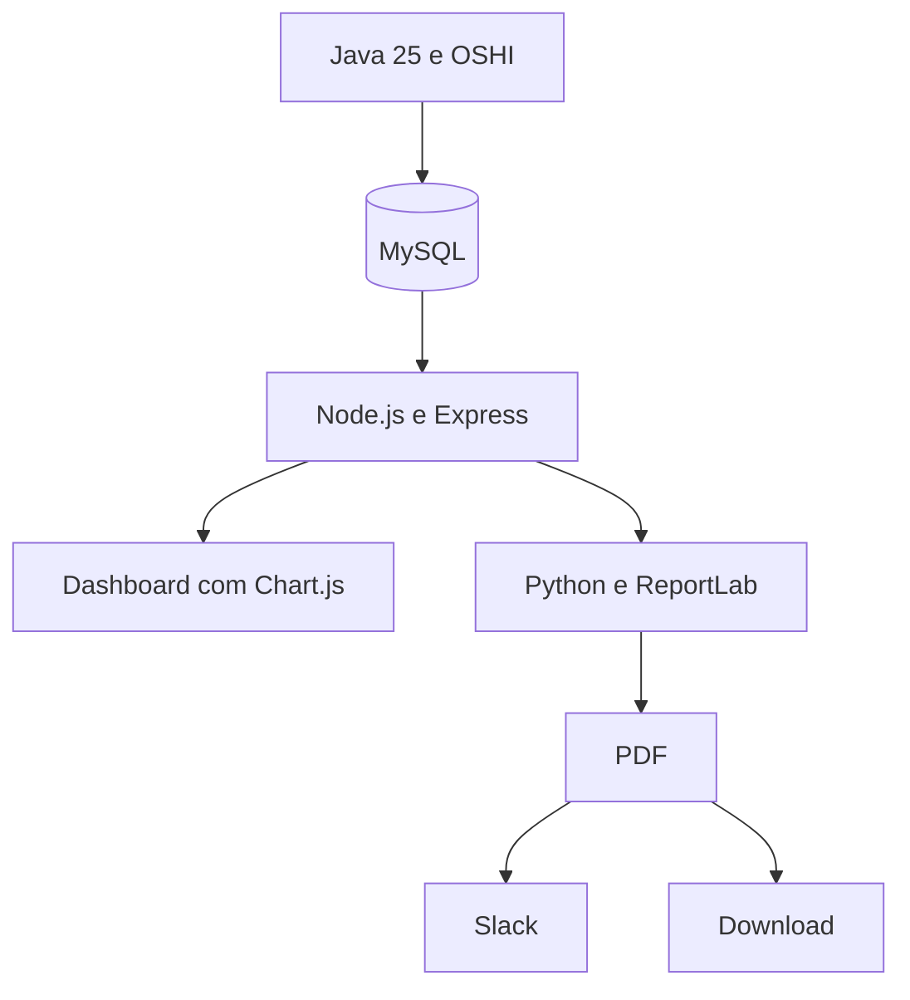

# Dashboard individual — redes

## 5. Escopo, funcionalidade e persona

**Persona:** Ana, gestora de infraestrutura definida na Sprint 2. A equipe de TI utiliza o detalhe por interface para investigar e encaminhar evidências.

**Problema:** uma mudança no tráfego ou a falta de registros não informa, isoladamente, qual interface precisa de investigação ou o que aconteceu.

**Funcionalidade:** análise de tráfego RX/TX, contadores locais e atualidade da coleta, com filtros de máquina, interface e período. O PDF consolida as evidências e suas limitações para encaminhamento à equipe.

**Decisão apoiada:** escolher a máquina/interface e a janela que precisam de investigação, separando tráfego, erros locais e ausência de evidência.

## 6. Fluxo dos dados e tecnologias

O Java registra deltas e duração. O backend calcula indicadores, a dashboard apresenta o recorte e o Python produz o PDF utilizando o mesmo contrato de dados. O banco é compartilhado com os demais módulos.

## 7. Resultado na visão da persona

1. Abrir **Análise de rede** pela navegação operacional.
2. Selecionar uma máquina e uma interface, identificando a origem dos dados.
3. Localizar uma mudança no gráfico RX/TX e consultar o período correspondente.
4. Verificar contadores locais, estado reportado e cobertura antes de interpretar a mudança.
5. Mostrar a diferença entre informação indisponível e zero observado.
6. Explicar a ação apoiada: encaminhar uma investigação específica com evidências, sem atribuir causa raiz apenas a Mbps.

Utilizar registros identificados como demonstração quando a apresentação ocorrer em ambiente de demonstração. Apontar as condições efetivamente observadas, sem supor que um erro ou falha aconteceu.

## 8. Relatório enviado na visão da persona

1. Gerar o PDF do recorte exibido e selecionar o envio ao Slack.
2. Abrir o documento e identificar máquina, interface, período e fuso.
3. Mostrar os gráficos, indicadores e observações, relacionando-os à análise feita na tela.
4. Abrir o arquivo no canal quando o envio tiver sido concluído.
5. Se o envio estiver impedido por permissão ou configuração, apresentar o download disponível e explicar a pendência real.

## Resumo do aprendizado

- Diferenciar tráfego, erros locais, estado operacional e disponibilidade de um serviço.
- Calcular taxas por deltas e tempo monotônico, tratando reinício de contadores.
- Distinguir zero de ausência de dados e representar lacunas no gráfico.
- Preservar o escopo por empresa, máquina e interface na consulta.
- Integrar Java, MySQL, Node.js, Python e Slack mantendo um contrato de métricas.
- Manter consistência visual com os componentes e tokens do AeroGuard.

## Agradecimentos

À equipe AeroGuard pela integração entre os módulos e aos docentes da SPTech pelas orientações do projeto.
