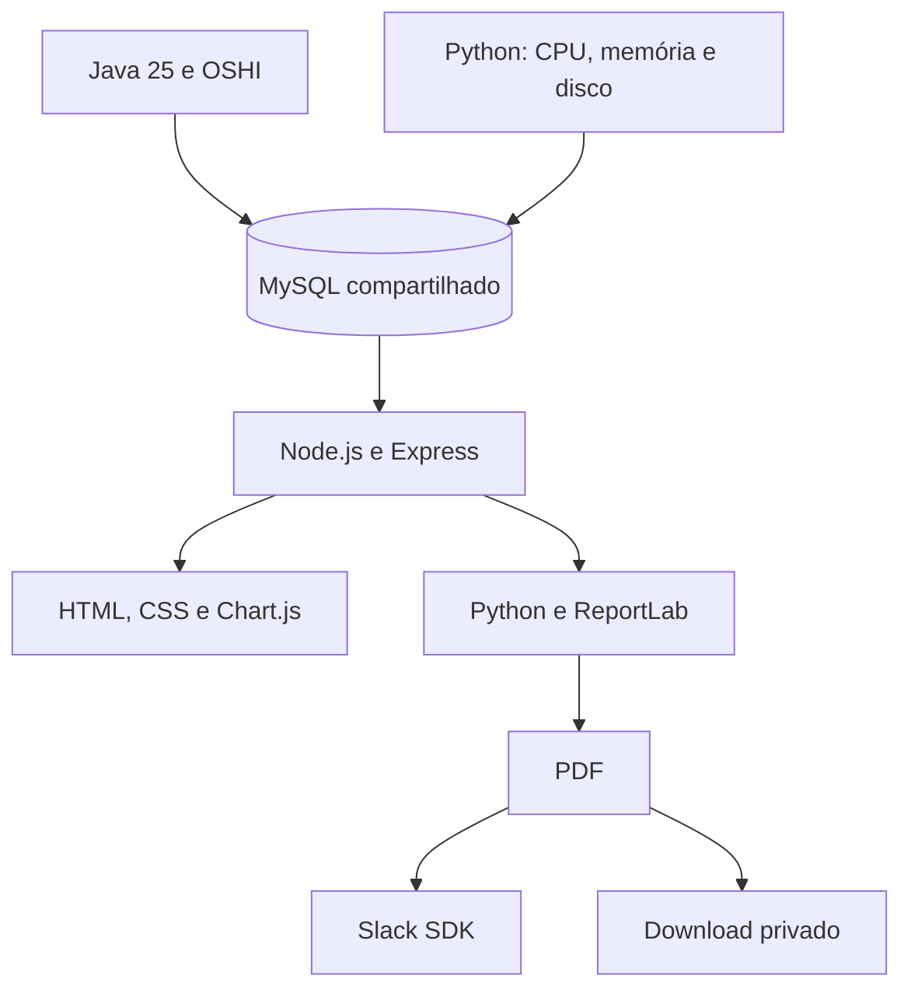

# Análise de rede

A página `redes.html` apoia Ana, gestora de infraestrutura do AeroGuard, e a equipe de TI na investigação de uma máquina e interface. Ela reúne tráfego RX/TX, contadores locais, estado reportado e atualidade dos registros, permitindo encaminhar um PDF com as evidências do período.

## Fluxo dos dados



O Java mantém as duas taxas legadas em `captura` e acrescenta uma leitura por interface em `captura_rede`, na mesma transação. Essa leitura preserva a duração monotônica, os deltas de bytes e contadores, os instantes de coleta e chegada e o estado operacional.

OSHI identifica interfaces e estado operacional. As estatísticas Linux são lidas com tratamento explícito de ausência ou falha, para que um contador indisponível não seja confundido com zero observado. Os contadores abrangem o tráfego da interface, incluindo outros processos e a própria telemetria; não identificam uma aplicação específica.

O backend faz os cálculos de negócio. A página apresenta a resposta e o Python transforma esse mesmo contrato em PDF. Assim, o relatório não implementa uma segunda fórmula de média ou volume.

## Banco compartilhado e coletor individual

Para um banco novo, utilizar `src/database/AeroGuard.sql`. Para uma instalação existente, aplicar somente:

```sh
mysql -u USUARIO -p < src/database/atualizacoes/001_captura_rede.sql
```

A atualização acrescenta `captura_rede` e pode ser reaplicada. Deve ser disponibilizada a todos os módulos a partir do Site, antes de implantar o Java da branch `feat/telemetria-redes-yuri`. O coletor não executa DDL. Os coletores antigos e suas tabelas continuam atendidos.

A máquina pertence a uma empresa pelo cadastro existente. O componente Rede e sua configuração vinculam a nova leitura à máquina. Uma configuração desabilitada impede a persistência pelo coletor.

Os nomes das interfaces distinguem maiúsculas e minúsculas, conforme os identificadores do Linux. Interfaces diferentes não são somadas nem têm suas séries misturadas.

## Dashboard

Filtros: máquina, interface e períodos de 1h, 6h, 24h ou 7d. A atualização automática ocorre a cada quinze segundos e pode ser pausada. A tabela abre o recorte de cada máquina/interface. O histórico básico pode ser selecionado explicitamente.

Os cartões apresentam recepção, transmissão, erros RX/TX e descartes RX separados, além da idade do último registro. O resumo acrescenta médias ponderadas, volumes e cobertura quando a origem permite calculá-los. Lacunas não são preenchidas com zeros.

A navegação mantém Visão Geral, Máquinas, Análise de CPU, Análise de rede e os itens administrativos conforme o perfil. A estrutura visual utiliza os componentes descritos em `DESIGN_SYSTEM.md`. Chart.js 4.4.8 é servido localmente em `public/assets/vendor/`, com sua licença preservada, para que os gráficos não dependam do carregamento de um CDN.

## Métricas

- Taxa em Mbps: `delta_bytes × 8000 / duracao_ns`.
- Média ponderada: `soma(delta_bytes) × 8000 / soma(duracao_ns)`.
- Volume: soma dos bytes nos intervalos completos incluídos na janela.
- Cobertura: duração da união dos intervalos válidos, recortados pela janela, dividida pela duração da janela. Não representa uptime.
- Contadores: somas separadas de erros RX, erros TX e descartes RX, com indicação de leituras parciais.

Intervalos que cruzam o início da consulta contribuem para cobertura e gráfico, mas não têm seus bytes ou contadores estimados nas bordas. Reinícios de bytes, troca de MAC e saltos do relógio invalidam a comparação. Contadores sem suporte permanecem ausentes. Um reinício apenas de um contador local não cria um delta negativo.

O histórico básico permite mostrar taxas e máximos; não registra duração, volume exato, contadores ou cobertura. As fontes não são somadas para o mesmo recorte. As curvas podem ter pontos reduzidos, preservando extremos e lacunas; os indicadores utilizam os dados anteriores à redução.

Mbps descreve tráfego. O estado UP não garante o funcionamento de um serviço. Descartes locais não equivalem à perda de ponta a ponta. Não há limite universal de alerta em Mbps ou percentual de capacidade calculado sobre a velocidade nominal de uma placa. Os alertas automáticos de rede continuam fora deste recorte.

## Relatório PDF

Na página, selecionar a máquina, interface e período e clicar em **Gerar relatório PDF**. A opção **Enviar também ao Slack** faz o upload após a geração. O relatório usa a janela exibida no momento da solicitação e informa a origem e as limitações dos dados.

O arquivo fica fora de `public/`. O link de download é temporário, identificado por um código aleatório, e expira após quinze minutos. O envio ao Slack não é automático nem recorrente. Uma falha de upload preserva o download e informa que o documento não foi enviado.

A imagem Docker do Site inclui o ambiente Python do relatório. Para execução sem Docker:

```sh
python3 -m venv .venv
.venv/bin/pip install -r relatorios/redes/requirements.txt
RELATORIO_PYTHON="$PWD/.venv/bin/python" npm start
```

O mesmo gerador também pode consultar a API pela linha de comando:

```sh
.venv/bin/python relatorios/redes/gerar_relatorio.py \
  --api-url http://127.0.0.1:3333 \
  --empresa 1 --maquina 3 --interface eth0 --periodo 6h \
  --saida relatorios-gerados/relatorio-rede.pdf --enviar-slack
```

Os identificadores são exemplos. `SLACK_BOT_TOKEN` permanece no ambiente; habilitação e destino vêm de `configuracao_slack`. O campo `canal` precisa conter o ID do canal, começando por C ou G. O aplicativo deve ter acesso ao canal e a permissão `files:write`. Os campos de modo, nível e cooldown das notificações existentes não filtram o relatório solicitado.

As datas de consulta e transporte usam UTC. Tela e PDF exibem `America/Sao_Paulo`. A última chegada ao banco e o instante declarado pelo coletor são informações distintas.

## Rotas

| Método e caminho | Finalidade |
| --- | --- |
| `GET /monitoramento/redes/:empresaId` | Contexto, indicadores, séries, interfaces e observações |
| `POST /monitoramento/redes/:empresaId/relatorios` | Iniciar a geração, com `enviarSlack` opcional no corpo |
| `GET /monitoramento/redes/:empresaId/relatorios/:id` | Consultar o resultado da geração e do envio |
| `GET /monitoramento/redes/:empresaId/relatorios/:id/pdf` | Baixar o arquivo enquanto disponível |

A consulta aceita `maquinaId`, `interface`, `periodo` e `fonte=basica`. Relatórios preservam `inicio` e `fim` em UTC. A API valida a relação entre empresa, máquina e interface. A identificação por empresa segue o fluxo existente do Site; isolamento de acesso com dados de empresas reais exige identidade autenticada no servidor, além do identificador de navegação armazenado no navegador.

## Fontes técnicas

- [Google SRE: Monitoring Distributed Systems](https://sre.google/sre-book/monitoring-distributed-systems/).
- [Linux: Interface statistics](https://docs.kernel.org/networking/statistics.html).
- [Linux: Operational States](https://docs.kernel.org/networking/operstates.html).
- [OSHI 7.7.2: NetworkIF](https://github.com/oshi/oshi/blob/oshi-parent-7.7.2/oshi-common/src/main/java/oshi/hardware/NetworkIF.java).
- [AWS: Network bandwidth](https://docs.aws.amazon.com/AWSEC2/latest/UserGuide/ec2-instance-network-bandwidth.html).
- [Slack: Uploading files with Python](https://docs.slack.dev/tools/python-slack-sdk/tutorial/uploading-files/).
