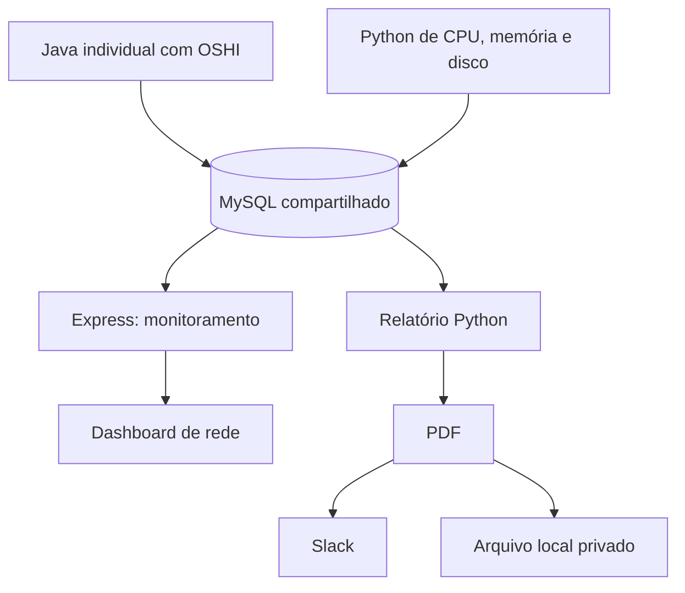

# AeroGuard — planejamento da dashboard individual de redes

**Responsável:** Yuri Garcia Pardinho

**Data:** 27/11/2026

**Branch do Site:** `feat/dashboard-redes-yuri`

**Situação:** proposta de implementação; alterações de banco dependem de alinhamento com a responsável pelo schema compartilhado.

## 1. Decisão de produto

Construir a página **Análise de rede**, voltada à investigação de tráfego e integridade das interfaces das máquinas monitoradas. A pergunta central é: **qual máquina e interface precisam de atenção, em que período e com quais evidências?**

A entrega individual combina uma dashboard no Site, uma evolução pequena do coletor Java em branch própria e um relatório produzido em Python, enviado em PDF pelo Slack. O banco continua único para o grupo. A versão inicial da página também deve funcionar com o histórico de Mbps já existente, indicando as informações que dependem da evolução do coletor.

O problema atendido é a falta de evidências consolidadas para orientar a investigação de rede. Tráfego alto, interface com erros e máquina sem registros exigem ações diferentes. A página deve tornar essa diferença visível e permitir encaminhar um relatório com o mesmo recorte da análise.

Não há base para atribuir um limite universal de alerta a Mbps. A recomendação é manter os alertas automáticos de rede adiados e entregar primeiro observações verificáveis. Não haverá classificação automática de rede “saudável” ou “crítica” apenas por volume de tráfego.

## 2. Persona e relação com a entrega individual

**Persona principal: Ana, 37 anos, gestora de infraestrutura**, já presente na página 10 da apresentação da Sprint 2. Ela valoriza informação direta e relatórios objetivos, e precisa de evidências consolidadas para acompanhar a infraestrutura. O analista de TI, também previsto no Lean UX do grupo, é o usuário operacional que investiga os sinais e encaminha as evidências à gestora.

O recorte de redes é uma hipótese de solução para essa persona existente. Não representa uma nova entrevista ou uma necessidade já validada em campo. Uma validação curta com o grupo deve confirmar se Ana precisa principalmente priorizar máquinas, investigar uma interface ou receber um resumo periódico. Isso não impede iniciar a implementação do recorte proposto.

| Necessidade | Elemento da entrega | Decisão que ajuda a tomar |
| --- | --- | --- |
| Entender mudanças no tráfego | Série de recepção e transmissão por interface | Delimitar quando a mudança ocorreu e qual direção investigar |
| Separar tráfego de problemas locais | Erros RX/TX, descartes RX e estado operacional | Encaminhar investigação da interface, do sistema ou da infraestrutura |
| Saber se há evidência suficiente | Idade da última leitura e cobertura do período | Investigar primeiro a coleta ou prosseguir com a análise dos valores |
| Comunicar uma ocorrência | PDF com período, máquina, interface e limitações | Compartilhar evidências sem depender de capturas de tela |

A apresentação individual deve explicar a decisão apoiada por cada indicador. A meta de redução de tempo de identificação citada na documentação do grupo é uma meta do projeto, ainda sem medição que comprove seu alcance. O protótipo usa máquinas e ambientes de demonstração; não deve alegar diagnóstico de sistemas aeronáuticos reais ou conformidade regulatória.

### Atendimento ao enunciado

| Exigência | Planejamento |
| --- | --- |
| Problema específico de uma persona | Investigação e priorização de evidências de rede para Ana e a equipe de TI |
| Navegação entre dashboards individuais | Item “Análise de rede” na navegação operacional, ao lado da análise de CPU já integrada; incorporar os demais painéis quando existirem |
| Navegação conforme acesso | Reutilizar os elementos administrativos condicionados ao perfil, mantendo a navegação de análise disponível aos perfis previstos |
| Relatório elaborado em Python | Gerador dedicado, com consultas ao mesmo banco e contrato de métricas da página |
| Entrega em PDF por Slack ou e-mail | Priorizar Slack, já utilizado pelo AeroGuard; preservar o arquivo local caso o envio falhe |

O enunciado aceita o arquivo salvo localmente como mínimo. A entrega proposta inclui envio pelo Slack, condicionado às permissões do aplicativo, e informa com clareza quando houver apenas geração local.

## 3. Diagnóstico dos repositórios

Base de análise: repositórios atualizados em 27/11/2026. Os cinco repositórios estavam sem alterações locais e alinhados com suas respectivas branches remotas antes da criação da branch individual.

| Repositório | Base analisada | Consequência para o planejamento |
| --- | --- | --- |
| Site | `0b9257f`, integração da análise de CPU | Reaproveitar estrutura operacional, filtros, autenticação, Chart.js e Design System |
| java-client | `c5d42c7` | Já coleta RX/TX de rede com OSHI; evoluir a captura existente, sem outro coletor concorrente na mesma máquina |
| script-python | `851a46a`, integração da discretização | Preservar a coleta de CPU, memória e disco e a discretização do módulo; relatório de redes será um módulo separado |
| script-instalacao-pi | `6fdaed1` | Planejar seleção explícita da versão individual do Java na instalação, sem mudar o padrão do grupo |
| docker-compose | `dfe8635` | Manter serviços atuais; execução do relatório pode usar ambiente Python descartável separado |

O schema vigente está em **`Site/src/database/AeroGuard.sql`**. O repositório legado de banco não participa desta entrega. Os diagramas e textos antigos são referências de contexto; nomes de campos e comportamento de integração devem seguir o SQL e o código atuais.

### O que já existe no Java

`CapturaRede` acompanha contadores de bytes por interface. Calcula Mbps pela diferença entre duas leituras e pelo tempo monotônico efetivamente transcorrido. A primeira leitura cria a referência; alterações de MAC e regressão de contadores exigem nova referência. O ciclo principal é de cinco segundos.

As medições persistidas têm tipos como `Download - eth0` e `Upload - eth0`, unidade `Mbps`, máquina, componente, configuração e instante. A identificação da máquina por MAC não significa que apenas essa interface seja coletada: o Java acompanha as interfaces enumeradas pelo sistema.

O banco guarda a taxa calculada, mas não guarda o intervalo real usado no cálculo nem os deltas de bytes. Também não há registro específico de erros, descartes ou estado operacional da interface. A ausência de uma interface nas leituras seguintes não produz um evento de queda.

Portanto, os dados atuais permitem exibir tráfego por direção e interface, máximos observados e idade das capturas. Não permitem recuperar com precisão o volume transferido, o tempo realmente coberto ou a causa de uma lacuna.

### O que precisa de atenção no Site

O backend já segue `Routes → Controllers → Models → Database Config`. A análise de CPU utiliza a infraestrutura de monitoramento e consulta por empresa. Essa estrutura deve ser estendida, preservando as rotas existentes e `sessionStorage.EMPRESA_ID`.

As consultas genéricas atuais não bastam para redes: a seleção da última métrica particiona por componente e unidade, sem distinguir `tipo` e interface; outra consulta de série não retorna o tipo. Isso pode misturar recepção, transmissão e interfaces diferentes. A nova página precisa de uma consulta específica, sem alterar o significado das consultas utilizadas pelos painéis existentes.

O campo `configuracao_maquina.disponibilidade` representa configuração de habilitação da coleta. Não é evidência de disponibilidade observada da máquina ou da rede. A API de discretização atual está delimitada a CPU, memória e disco; seus percentuais não devem ser aplicados às taxas de rede.

## 4. Fundamentação das decisões

As fontes oficiais foram consultadas em 27/11/2026. As recomendações de produto abaixo são escolhas deste planejamento, apoiadas nessas definições técnicas.

| Evidência | Consequência para a solução |
| --- | --- |
| O Google SRE distingue tráfego, latência, erros e saturação [1] | Mbps será apresentado como tráfego; desempenho da aplicação e saturação não serão inferidos apenas desse número |
| A capacidade de rede EC2 depende de instância, limites e condições de tráfego [2] | Não dividir o tráfego pela velocidade nominal da placa nem criar limite fixo universal para classificar máquinas |
| Estatísticas Linux descrevem erros e descartes locais da interface [3] | Identificar precisamente RX, TX e descarte RX; não chamar esses contadores de perda de pacotes de ponta a ponta |
| O Linux distingue estados operacionais, inclusive UNKNOWN [4] | Estado desconhecido será exibido como desconhecido; “sem registros” terá interpretação separada de DOWN |
| OSHI 7.7.2 oferece estado operacional, erros RX/TX e descartes RX [5, 6] | Acrescentar esses campos na variante Java usando a dependência já existente; não assumir um método de descarte TX inexistente nessa API |
| As boas práticas de alertas enfatizam sinais acionáveis e sintomas [7] | Adiar notificações automáticas até existir regra específica, duração, destinatário e ação esperada |
| Slack oferece envio de arquivos pelo SDK Python [8] | Gerar o PDF em Python e usar `files_upload_v2`, com permissão de escrita de arquivos e canal identificado por ID |
| Chart.js permite lacunas e documenta redução de pontos [9, 10] | Usar eixo temporal real, não ligar lacunas, reduzir pontos do gráfico preservando os cálculos sobre os dados válidos |

O DECEA descreve o SAGITARIO no contexto de integração de informações de vigilância e controle [12]. Isso contextualiza a importância de infraestrutura no projeto, mas não comprova que um contador de rede detecte antecipadamente uma falha operacional específica.

### Conclusões que a dashboard pode sustentar

- Houve determinada taxa de recepção ou transmissão durante um intervalo observado.
- Contadores locais registraram erros ou descartes adicionais durante a janela analisada.
- A interface reportou determinado estado operacional em um instante.
- Há períodos sem evidências suficientes para calcular ou interpretar os indicadores.

### Conclusões que exigiriam outras medições

- Lentidão percebida pelo usuário: exige medição de tempo de resposta de um serviço definido.
- Perda entre origem e destino: exige observação apropriada do caminho ou transação; descartes locais não bastam.
- Saturação da capacidade: exige limite efetivo conhecido e aplicável ao recurso medido.
- Máquina indisponível: exige observação externa para diferenciar queda de rede, coletor parado, bloqueio do banco e outras causas.

Não incluir uma sonda para um endereço arbitrário. Uma evolução futura poderá acompanhar um serviço definido pelo grupo, com finalidade, destino autorizado e critérios próprios. Métricas ENA de limites excedidos são uma extensão possível somente onde o ambiente disponibilizar esses contadores [11].

## 5. Indicadores e regras de interpretação

A primeira versão trabalha com **quatro cartões principais** para a máquina e a interface selecionadas. Estado operacional, cobertura e origem dos dados ficam visíveis junto ao contexto da análise.

| Indicador | Cálculo ou origem | Ação apoiada e cuidado de interpretação |
| --- | --- | --- |
| Recepção atual | Última taxa RX válida em Mbps | Identificar tráfego recebido; manter data da leitura e indicar valor desatualizado quando houver lacuna |
| Transmissão atual | Última taxa TX válida em Mbps | Identificar tráfego enviado; não somar RX e TX para calcular um percentual de uma capacidade unidirecional |
| Erros e descartes locais no período | Deltas separados de erros RX, erros TX e descartes RX | Priorizar investigação local; mostrar três valores identificados, sem percentual de perda e sem uma soma que sugira pacotes únicos |
| Último registro recebido | Tempo desde a última chegada ao banco, na versão ampliada | Investigar lacunas; isso mede atualidade da telemetria, sem comprovar causa ou disponibilidade da rede |

Complementos: volume RX/TX no período coberto, maior taxa RX/TX observada, média ponderada, quantidade de intervalos válidos e cobertura da janela. Os valores calculados precisam identificar a janela utilizada. Um máximo observado em cinco segundos não é um pico instantâneo de duração menor que a coleta.

Com o coletor atual, o cartão de atualidade se refere ao instante declarado na captura, identificado assim na interface. Erros, descartes, volume exato e cobertura por duração aparecem como **“indisponível nesta versão do coletor”**. Não substituir uma informação ausente por zero.

### Contrato das métricas da versão ampliada

- `Mbps = 8 × delta_bytes / (duracao_ns / 1.000.000.000) / 1.000.000`.
- `Volume_GB = soma(delta_bytes) / 1.000.000.000`, separado em RX e TX, somente nos intervalos válidos incluídos. GB usa base decimal; se houver GiB, rotular a base explicitamente.
- `Media_Mbps = 8 × soma(delta_bytes) / soma(duracao_segundos) / 1.000.000`. A média não é uma simples média de taxas quando os intervalos têm durações diferentes.
- `Erros_RX`, `Erros_TX` e `Descartes_RX` são somas dos respectivos deltas válidos. Uma mesma ocorrência pode aparecer em estatísticas diferentes; não somar as categorias como se fossem perdas únicas.
- `Cobertura = duracao_da_uniao_dos_intervalos_validos_na_janela / duracao_da_janela`. Não somar sobreposições nem chamar esse resultado de uptime.
- `Idade_recebimento = agora_do_servidor - ultimo_recebido_em`. Comparar também os instantes da coleta e da chegada quando houver suspeita de atraso ou diferença de relógio.

Datas de consulta usam uma janela com início incluído e fim excluído. Para totais de bytes e contadores, incluir apenas intervalos inteiros contidos na janela, informando os limites efetivamente cobertos. Não ratear bytes de um intervalo parcial supondo distribuição uniforme. Cobertura pode recortar a duração nas bordas; o relatório deve explicar essa diferença. Saltos do relógio exigem marcar a posição temporal do intervalo como incerta; a taxa calculada por relógio monotônico não resolve essa incerteza de calendário.

### Estados e situações especiais

| Situação observada | Apresentação e tratamento |
| --- | --- |
| Delta válido igual a zero | Mostrar 0; significa ausência de tráfego contado naquele intervalo, sem diagnóstico automático de queda |
| Primeira leitura, contador regrediu ou MAC mudou | Criar nova referência; taxa e deltas sem comparação válida ficam ausentes |
| Leitura não suportada ou inacessível | Campo nulo e indicação de indisponibilidade; verificar suporte no Linux para não interpretar retorno padrão como zero observado |
| Estado DOWN ou LOWER_LAYER_DOWN | Mostrar estado reportado e horário; orientar verificação da interface e de sua dependência local |
| Estado UNKNOWN | Mostrar desconhecido, sem equiparar a DOWN |
| Falta de novas linhas | Mostrar a idade e a lacuna; listar hipóteses de coleta/conectividade, sem afirmar uma causa |
| Interface desapareceu da enumeração | Preservar seu histórico e indicar ausência de novas observações, sem fabricar estado DOWN |
| Coleta administrativamente desabilitada | Identificar configuração desabilitada; não contar como falha de disponibilidade |
| Múltiplas interfaces físicas e virtuais | Identificar cada interface; evitar totalizar interfaces que podem contar o mesmo tráfego em camadas diferentes |

Os cinco segundos da coleta e os quinze segundos de atualização da página refletem padrões já presentes nos repositórios. Qualquer tolerância para considerar dado atrasado é parâmetro de produto a calibrar, sem tratá-lo como norma de redes. O MVP mostra a idade exata mesmo antes de existir esse limiar.

## 6. Desenho da página

**Rota visual proposta:** `public/redes.html`. Título: **Análise de rede**. Subtítulo: “Tráfego, integridade local e atualidade das medições”.

### Organização visual

1. Navegação operacional existente: Visão geral, Máquinas, Análise de CPU, Análise de rede e os itens administrativos conforme o perfil.
2. Cabeçalho com empresa, contexto da máquina e data da última atualização.
3. Filtros de máquina, interface e período. Reutilizar janelas de 1h, 6h, 24h e 7d, com 6h inicial, atualização de quinze segundos e atualização manual. A escolha de interface precisa ficar explícita.
4. Quatro cartões principais. Exibir unidades, período e disponibilidade dos campos junto dos valores.
5. Gráfico principal: duas séries de tráfego, RX e TX, com tempo real no eixo horizontal e Mbps no eixo vertical. Tooltip com data, interface e duração da leitura quando disponível.
6. Gráfico de integridade: erros RX, erros TX e descartes RX por intervalo de agregação. Usar contagens, legenda e séries distintas; não usar o título “perda de pacotes”. No modo básico, explicar a dependência da versão ampliada.
7. Tabela de máquinas e interfaces: estado reportado, último registro, máximos RX/TX, contadores e cobertura. Uma linha por máquina/interface, sem somar interfaces. Clicar na linha aplica seus filtros e abre sua análise.
8. Resumo para encaminhamento: período coberto, evidências observadas e limitações. Informar como obter o relatório Python. O botão para acionar sua geração pelo navegador pode entrar depois do fluxo mínimo de PDF e Slack.

### Comportamentos importantes

- Empresa vem do fluxo já existente. Preferências de filtros podem ser locais, com chave por empresa, usuário e máquina; preferência local não é autorização.
- As consultas validam a associação da máquina e da configuração à empresa informada. Essa verificação não substitui uma identidade autenticada no servidor: `EMPRESA_ID` no navegador é contexto de navegação, não prova de autorização.
- Estados de carregamento, falta de cadastro, ausência de captura, coletor básico, erro de API e coleta desabilitada precisam de mensagens diferentes.
- Lacunas usam valores nulos e `spanGaps: false`. Não preencher períodos ausentes com zero nem conectar pontos separados por períodos sem leitura.
- Reduzir pontos enviados ao navegador em períodos longos. Calcular totais e máximos antes dessa redução. Para curvas de tráfego, preservar variações relevantes e retornar máximos brutos separadamente.
- Reutilizar Chart.js 4.4.8 já incluído no Site; eixo numérico de epoch e formatação com `Intl` permitem tratar tempo sem uma nova biblioteca de datas.
- Datas são persistidas e transportadas de forma inequívoca em UTC e exibidas em `America/Sao_Paulo`, incluindo o fuso no relatório.

### Fidelidade ao Design System

Partir de `docs/templates/dashboard/` e consultar `DESIGN_SYSTEM.md`, o guia de criação e o checklist de integração. Reutilizar `dashboard-layout`, sidebar, `dashboard-main`, `kpis`, `kpi`, `panel`, filtros segmentados, tabelas e botões existentes.

Manter Space Grotesk/Kanit, superfícies escuras e os tokens do projeto. RX pode usar `--signal`; TX, `--mem`, ambos acompanhados de rótulos. Cores de aviso só representam uma condição identificada. Nenhum significado depende apenas da cor. Respeitar os breakpoints operacionais, inclusive a reorganização da navegação em telas pequenas.

A inclusão de links deve ser consistente nas páginas operacionais. Não criar itens para dashboards ainda inexistentes. A chegada de cada nova página individual acrescenta seu link à mesma navegação.

## 7. Arquitetura proposta

Manter o caminho atual de persistência direta do coletor no MySQL. Não acrescentar Kafka, Redis, outro serviço de ingestão ou um framework de frontend para esta entrega.

### Java individual

Criar futuramente `feat/telemetria-redes-yuri` no `java-client`. Evoluir `CapturaRede`, `LeituraRede` e a persistência em `BancoDados`, mantendo o estilo atual de records, JDBC e OSHI. Não iniciar um segundo processo para ler as mesmas interfaces ao lado do Java existente: implantar uma versão por máquina.

A nova leitura mantém bytes, instantes e tempo monotônico, acrescentando `getInErrors()`, `getOutErrors()`, `getInDrops()` e `getIfOperStatus()`. Não é necessário coletar contagem de pacotes no MVP, pois não será calculado percentual de perda. `getSpeed()` pode ser metadado futuro; não será usado como capacidade efetiva de nuvem.

Persistir deltas e duração em uma estrutura de rede específica. A primeira leitura pode registrar estado e presença mesmo sem taxa válida. Detectar reinício de contador e troca de interface antes de subtrair, mantendo campos inválidos nulos. Reutilizar a referência de leitura existente; não introduzir processamento paralelo desnecessário.

Na transição, preservar as capturas RX/TX em `captura`, utilizadas pelo restante do grupo, e gravar a nova linha de rede na mesma transação. Confirmar a transação antes de qualquer notificação. A versão individual deve exigir o schema preparado, em vez de executar DDL na inicialização. A página continua capaz de ler apenas as capturas antigas quando uma máquina ainda utiliza o coletor básico.

### Site e API

Estender os arquivos existentes `src/routes/monitoramento.js`, `src/controllers/monitoramentoController.js` e `src/models/monitoramentoModel.js`, com funções específicas para redes. Uma separação posterior em módulo próprio só se justifica se o tamanho real exigir. Reutilizar a conexão existente.

Endpoint proposto:

`GET /monitoramento/redes/:empresaId?maquinaId=3&interface=eth0&periodo=6h`

O exemplo ilustra o contrato, sem afirmar a existência dessa máquina ou interface em um ambiente de produção. Aceitar apenas períodos previstos, IDs válidos e interfaces cadastradas/observadas para a máquina consultada. As consultas usam parâmetros SQL; strings de interface não compõem SQL por concatenação.

A resposta deve conter: contexto da empresa/máquina/interface; início e fim da janela; instante de geração no servidor; origem e capacidades dos dados; indicadores; séries; interfaces disponíveis; informações de lacunas e estado operacional. Campos avançados indisponíveis são nulos com indicação de capacidade, sem zeros artificiais.

As rotas de monitoramento analisadas recebem a empresa pela URL e não possuem middleware de sessão autenticada. Preservar a navegação exigida pelo enunciado e os filtros por empresa não elimina essa limitação. Antes de uma exposição com dados reais de empresas distintas, o grupo precisa vincular a empresa à identidade autenticada no servidor, em uma mudança compartilhada de autorização. Não prometer isolamento entre empresas baseado apenas em `sessionStorage` ou nos parâmetros da URL.

Centralizar os cálculos de negócio no backend para a página. O Java calcula os intervalos medidos; o frontend formata e apresenta. O relatório Python segue o mesmo contrato de fórmulas e unidades. Os cálculos SQL que forem compartilháveis podem ficar em consultas parametrizadas documentadas, evitando três interpretações diferentes da mesma métrica.

Limitar quantidade de pontos e volume da consulta. Para períodos longos, retornar agregações temporais e os indicadores calculados sobre os intervalos válidos. Uma meta inicial de aproximadamente 300 pontos por série é decisão de implementação, sujeita ao comportamento real da página.

Não transformar “gráfico por minuto” em “média simples de amostras”: a agregação respeita a duração. O cartão de último valor utiliza a última leitura válida, sem confundir esse valor com a média do último bloco.

## 8. Contrato de banco compartilhado

**Proposta recomendada:** uma tabela adicional `captura_rede`, com uma linha por leitura de interface. Não modificar o sentido de `captura`, `discretizacao` ou `historico_alerta`. Os campos abaixo são um contrato conceitual para revisão da responsável pelo banco, não uma migration pronta para execução.

| Grupo | Campos propostos | Finalidade |
| --- | --- | --- |
| Identidade | `id`, `maquina_id`, `config_maquina_id` | Relacionar a leitura à máquina e à configuração habilitada do componente Rede |
| Interface | `interface_nome`, `interface_mac` | Distinguir interfaces e mudanças da referência de coleta |
| Tempo | `inicio_em`, `coletado_em`, `recebido_em`, `duracao_ns` | Preservar intervalo, coleta, chegada ao banco e duração monotônica |
| Tráfego | `delta_rx_bytes`, `delta_tx_bytes` | Permitir taxas, médias ponderadas e volumes por direção |
| Integridade local | `delta_rx_erros`, `delta_tx_erros`, `delta_rx_descartes` | Preservar deltas de estatísticas locais sem usar unidade Mbps |
| Estado e validade | `estado_operacional`, `motivo_intervalo` | Identificar estado reportado, início de referência, reinício de contador ou leitura inválida |

Recomendações para o desenho físico: identificador BIGINT; contadores e duração inteiros com amplitude suficiente; datas com microssegundos; nulabilidade para leituras sem suporte ou sem intervalo comparável; estados com nomes documentados. `recebido_em` é atribuído pelo banco central. A conexão e a serialização devem ter tratamento UTC explícito.

Índice principal de consulta por máquina, interface e instante. Uma unicidade equivalente também pode impedir duplicação na repetição da mesma escrita, desde que a identidade da leitura seja preservada no retry. A política de repetição não deve gerar novo horário para a mesma observação.

Garantir que a configuração pertence à mesma máquina e ao componente Rede. A empresa é derivada da máquina, evitando mais uma cópia divergente de `empresa_id`. As chaves e eventuais restrições compostas devem ser definidas pela responsável pelo schema. Nomes de campos e tamanhos finais devem acompanhar o padrão do SQL oficial.

Não gravar estado operacional como número arbitrário em `valor` nem empacotar vários campos em `tipo`. O modelo atual de discretização tem limite inteiro e nível, mas não identifica unidade, direção ou interface. Também há dependência de uma captura em `historico_alerta`; isso não representa adequadamente ausência de telemetria. Esses modelos não serão reutilizados para criar alertas de rede neste MVP.

### Transição e compatibilidade

1. Revisar este contrato com a responsável pelo banco e publicar a evolução compartilhada a partir do Site.
2. Preparar uma instância isolada com o SQL aprovado e dados de demonstração identificados como tal.
3. Integrar API e página com leitura básica e ampliada. A seleção deve usar uma fonte única por recorte, sem somar as duas fontes para o mesmo intervalo. Se a janela ampliada alcançar datas anteriores à sua adoção, mostrar sua cobertura incompleta; a consulta ao histórico básico permanece disponível de forma identificada.
4. Implantar a versão Java individual somente nas máquinas que participarão da nova coleta.
5. Ajustar a instalação para selecionar explicitamente a versão individual, preservando a versão padrão do grupo.

Leituras anteriores à adoção da nova tabela continuam básicas. Não preencher retroativamente erros, estado ou duração desconhecidos. Não executar alterações no banco compartilhado como parte do planejamento.

### Crescimento dos dados

Com intervalo de cinco segundos, uma interface produz **17.280 leituras por dia**. Mantendo duas linhas legadas RX/TX e uma linha nova por ciclo, são **51.840 linhas por dia por interface**. Duas interfaces geram 103.680 linhas por dia, ou 725.760 linhas em sete dias, somadas as duas tabelas. Esses números são projeções matemáticas, sem estimativa de tamanho em disco.

É necessário decidir com o grupo retenção, interfaces relevantes e agregação histórica antes de manter coleta indefinida. Não purgar dados sem política acordada. Evitar adicionar dependências pagas de observabilidade; o orçamento reduzido descrito na documentação favorece a infraestrutura atual. Capacidade e custo efetivos dependem do ambiente que será utilizado.

## 9. Relatório Python e Slack

Criar um módulo separado em `Site/relatorios/redes/`, na branch individual. Isso mantém o relatório e sua documentação próximos da dashboard sem alterar o script de coleta Python de outro integrante.

O fluxo mínimo será uma execução explícita do gerador, com empresa, máquina/interface e janela selecionadas. A versão final deve documentar um comando equivalente a:

`python gerar_relatorio.py --empresa 1 --maquina 3 --interface eth0 --periodo 6h --enviar-slack`

IDs e interface são exemplos de uso. Validar parâmetros, consultar somente a empresa solicitada e gerar o arquivo fora de `public/`. O comando é uma interface planejada, ainda não implementada.

Usar ambiente virtual próprio ou contêiner de execução única, sem acrescentar Python à imagem web por conveniência. `mysql-connector-python` e `slack-sdk` já pertencem ao ecossistema do projeto; ReportLab e Matplotlib se justificam, respectivamente, pela produção do PDF e gráficos estáticos. Verificar as versões existentes antes de definir os requisitos do módulo.

### Conteúdo do PDF

- Empresa, máquina, interface, janela e fuso horário.
- Instantes de geração, coleta mais recente e chegada mais recente, conforme a fonte permitir.
- Tráfego RX/TX, máximos observados e, no modo ampliado, médias ponderadas e volumes cobertos.
- Gráficos de tráfego e integridade local, com lacunas visíveis.
- Cobertura e limitações: dados básicos, contadores indisponíveis, intervalos inválidos e ausência de registros.
- Observações objetivas para encaminhamento; sem declarar causa raiz, SLA atendido ou perda de ponta a ponta sem medição correspondente.

### Configuração e entrega

Manter `SLACK_BOT_TOKEN` como segredo de integração no ambiente. Usar `configuracao_slack` para habilitação e destino, preservando as demais configurações do grupo. As variáveis de conexão com banco e identificação já utilizadas pelos módulos seguem seu papel atual; a decisão é não criar configuração funcional de Slack no `.env`.

O upload usa `files_upload_v2`, permissão `files:write`, canal identificado por ID e acesso do aplicativo ao canal. O funcionamento de mensagens de texto não comprova essa permissão de arquivo. Se `canal` ainda contiver um nome como `#alertas-criticos`, definir e registrar o ID correto na configuração compartilhada, considerando os outros emissores. Não adicionar consulta ampla de canais e permissões extras apenas para resolver o nome em cada envio.

Respeitar `ativo`. `modo`, `nivel_minimo` e `cooldown_min` controlam notificações de monitoramento existentes; não devem filtrar silenciosamente um relatório solicitado pelo usuário. O fluxo do relatório deve declarar que o documento foi solicitado e informar seu resultado de entrega. Não criar agendamento recorrente por padrão.

Se o upload não for possível, manter o PDF em diretório privado e retornar “gerado, envio não concluído”. Não apresentar falha de envio como sucesso. O relatório não inclui token, senha ou dados de conexão.

Um botão web para iniciar a geração é uma evolução opcional. Caso seja incluído, precisa validar a empresa no servidor, limitar execução, evitar montagem de shell com parâmetros do navegador e mostrar o resultado do processamento. Não introduzir um microserviço e uma fila apenas para a primeira entrega individual.

## 10. Política de observações e alertas

| Evidência disponível | Pode aparecer na página? | Notificação automática no MVP? |
| --- | --- | --- |
| Tráfego RX/TX aumentou | Sim, com período, direção e valores | Não; aumento isolado não determina falha |
| Erros ou descartes locais tiveram delta positivo | Sim, com categoria e contagem | Não; primeiro definir persistência, relevância e procedimento de resposta |
| Interface reportou DOWN | Sim, como estado observado | Não; avaliar interfaces esperadas e manutenção antes de notificar |
| Não chegaram novos registros | Sim, como lacuna e idade | Não; coletor, banco e conectividade são hipóteses diferentes |
| Restrição ENA comprovada pelo contador aplicável | Somente em evolução compatível com o ambiente | Fora do MVP |
| Latência ou perda de ponta a ponta | Somente após medição específica | Fora do MVP |

Uma futura regra de alerta precisa documentar métrica, unidade, interface/recurso, duração, condição de recuperação, destinatário e ação esperada. Nenhum limiar de 80%, 90% ou determinada quantidade de Mbps será herdado de CPU, memória ou disco.

O modo `CONFIGURADO` do Slack continua dependendo de alertas persistidos compatíveis. O relatório PDF solicitado é um fluxo próprio; não deve depender de inventar alertas de rede para funcionar.

## 11. Sequência de implementação

As estimativas abaixo são de esforço concentrado, não um calendário de entrega. Revisão do banco e disponibilidade da equipe podem alterar o prazo. A ordem permite entregar algo útil mesmo antes da evolução da coleta.

| Etapa | Entrega concreta | Estimativa inicial | Critério de conclusão |
| --- | --- | --- | --- |
| 1. Contrato e recorte | Persona, indicadores, interface e contrato de dados alinhados com o grupo | 2–3h | Responsabilidades e limitações aceitas, sem dependências implícitas |
| 2. Página com dados atuais | Rota de rede, filtros, RX/TX, máximos, atualidade e navegação | 6–9h | Séries separadas por empresa, máquina, interface e direção; lacunas e campos ausentes claros |
| 3. Banco e Java individual | Estrutura adicional aprovada, deltas, duração, contadores e estado | 6–10h | Escrita compatível com o grupo e uma versão do coletor por máquina |
| 4. Análise ampliada | Contadores, volume, médias, cobertura e tabela de investigação | 5–8h | Indicadores rastreáveis aos intervalos, sem interpretações indevidas |
| 5. Relatório e entrega | Gerador Python, PDF e upload Slack ou fallback local explícito | 4–6h | Arquivo legível, mesmo recorte da página e resultado de envio identificado |
| 6. Integração e apresentação | Navegação entre painéis, responsividade, documentação e roteiro | 3–5h | Jornada completa de investigação até o encaminhamento do relatório |

Total preliminar: **26–41 horas**, sem contar espera por decisões compartilhadas. Se o prazo for menor, a redução recomendada é entregar a página com tráfego real e o PDF básico, deixando claros os indicadores ainda indisponíveis. Não reduzir o escopo simulando métricas inexistentes.

### Dependências e responsáveis

- Yuri: página individual, consultas de rede, variante Java e módulo de relatório.
- Responsável pelo banco: desenho físico e evolução do schema compartilhado.
- Responsável pelo Python: alinhamento das variáveis e dependências, sem transferência da manutenção do coletor existente.
- Grupo: navegação entre painéis, máquina/interface representativa da demonstração e destino Slack.

Antes de integrar a página, revisar o comportamento da conexão do backend e seus caminhos de erro; a implementação existente tem encerramento de conexão próximo do tratamento de falhas. Isso é um ponto de revisão de integração, não uma falha reproduzida nesta etapa. A atualização recente da discretização Python já integra a base analisada e não deve ser substituída por uma correção baseada em versão antiga.

## 12. Critérios de aceite e roteiro de apresentação

### Produto

- Ana identifica uma máquina/interface, seleciona um período e entende quais evidências estão disponíveis.
- Recepção e transmissão nunca são misturadas em uma única série sem identificação.
- Um valor zero observado, uma leitura indisponível e um período sem captura têm apresentações distintas.
- Erros locais não são chamados de perda de pacotes de ponta a ponta.
- A página não exibe percentual de utilização sem conhecer uma capacidade aplicável.
- A tabela permite abrir o recorte de uma máquina/interface, mantendo a identificação da empresa.
- A navegação permite ir da visão geral à CPU e à rede e voltar, respeitando os perfis existentes.
- O relatório é produzido por Python, mantém o recorte e explicita lacunas e limites dos dados.
- O PDF chega ao Slack quando a permissão está disponível; caso contrário, existe um arquivo local e uma indicação correta de falha de envio.

### Integração

- A implantação de banco é compartilhada e versionada no Site; não existe um schema particular divergente.
- O coletor básico continua atendido, enquanto a versão individual acrescenta campos sem fabricar histórico anterior.
- Pausa da coleta, reinício de contadores e alteração de interface não geram taxas negativas ou picos artificiais.
- Uma consulta rejeita combinações de empresa e máquina que não correspondem entre si. A proteção contra substituição conjunta desses identificadores depende da evolução compartilhada de autorização no servidor descrita na seção 7.
- Gráficos de períodos longos não enviam todas as leituras brutas ao navegador.
- Layout segue os componentes e breakpoints do Design System, com rótulos e mensagens compreensíveis.

### Apresentação sugerida

Começar pelo problema de Ana: há uma mudança percebida e ela precisa encaminhar evidências à equipe. Abrir uma máquina e interface identificadas, analisar RX/TX e a janela da mudança, verificar contadores locais e a qualidade da evidência, apontar o que ainda não é possível concluir e gerar o PDF para encaminhamento.

Para demonstrar situações que não ocorrerem naturalmente, utilizar dados de demonstração identificados e ambiente isolado. Não interromper a interface de acesso remoto nem produzir tráfego sobre um sistema operacional real do contexto aeronáutico. Não apresentar dados fabricados como registros reais.

## 13. Organização das branches e alterações previstas

| Local | Alterações planejadas |
| --- | --- |
| Site, `feat/dashboard-redes-yuri` | Página, estilos específicos, apresentação, funções de API de rede, relatório Python e este planejamento |
| java-client, futura `feat/telemetria-redes-yuri` | Evolução pontual da leitura e persistência de rede, mantendo as dependências atuais |
| Site, mudança compartilhada do banco | SQL aprovado e procedimento de atualização; coordenação com a responsável antes de mesclar |
| script-instalacao-pi | Seleção explícita da variante quando houver implantação, sem trocar a versão padrão de todos |
| script-python e docker-compose | Sem alteração obrigatória para o primeiro recorte; revisar somente se a integração aprovada exigir |

Arquivos previstos no Site: `public/redes.html`, `public/css/redes.css`, `public/js/redes.js`, funções adicionais nos três arquivos de monitoramento e `relatorios/redes/`. Acrescentar código de cálculo no frontend somente para apresentação; as métricas de negócio pertencem ao contrato de API.

Separar commits por finalidade. Sugestões:

- `docs(redes): planejar dashboard individual de redes`
- `feat(redes): adicionar análise de tráfego por interface`
- `feat(client): registrar integridade local das interfaces`
- `feat(redes): gerar relatório de rede em PDF`

O documento define o trabalho antes da implementação. As próximas mudanças devem permanecer pequenas, vinculadas aos indicadores e compatíveis com o restante do AeroGuard.

## 14. Referências

**Materiais do projeto:** apresentação “AEROGUARD — SPRINT 2”, especialmente páginas 9–10, 15 e 26; “DOCUMENTAÇÃO-AEROGUARD-GRUPO-07-1”, especialmente escopo, stakeholders, riscos e requisitos; enunciado “Escopo projeto individual”, página 11. Código e SQL prevalecem para contratos já implementados. Versões dos repositórios: seção 3.

Fontes primárias consultadas em 27/11/2026:

1. Google SRE. Monitoring Distributed Systems. https://sre.google/sre-book/monitoring-distributed-systems/
2. AWS. Amazon EC2 instance network bandwidth. https://docs.aws.amazon.com/AWSEC2/latest/UserGuide/ec2-instance-network-bandwidth.html
3. Linux Kernel. Interface statistics. https://docs.kernel.org/networking/statistics.html
4. Linux Kernel. Operational States. https://docs.kernel.org/networking/operstates.html
5. OSHI, versão 7.7.2. NetworkIF. https://github.com/oshi/oshi/blob/oshi-parent-7.7.2/oshi-common/src/main/java/oshi/hardware/NetworkIF.java
6. OSHI, versão 7.7.2. LinuxNetworkIF. https://github.com/oshi/oshi/blob/oshi-parent-7.7.2/oshi-common/src/main/java/oshi/hardware/common/platform/linux/LinuxNetworkIF.java
7. Prometheus. Alerting. https://prometheus.io/docs/practices/alerting/
8. Slack. Uploading files with Python. https://docs.slack.dev/tools/python-slack-sdk/tutorial/uploading-files/
9. Chart.js. LineOptions. https://www.chartjs.org/docs/latest/api/interfaces/LineOptions.html
10. Chart.js. Performance. https://www.chartjs.org/docs/latest/general/performance.html
11. AWS. Monitor network performance for ENA settings. https://docs.aws.amazon.com/AWSEC2/latest/UserGuide/monitoring-network-performance-ena.html
12. DECEA. SIGMA e SAGITARIO: conheça os sistemas que controlam o tráfego aéreo brasileiro, 25/07/2024. https://www.decea.mil.br/?i=midia-e-informacao&materia=sigma-e-sagitario-conheca-os-sistemas-que-controlam-o-trafego-aereo-brasileiro&p=pg_noticia
